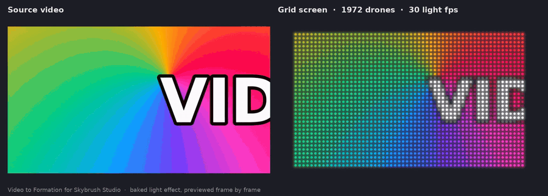
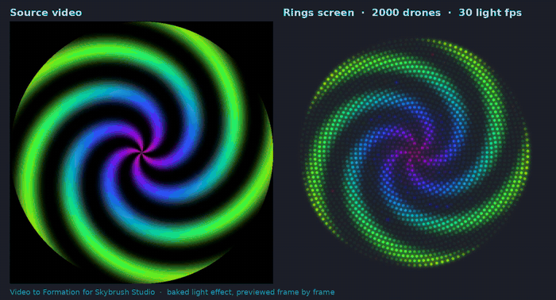

# Video to Formation

A Blender extension for [Skybrush Studio](https://skybrush.io) that plays a video on a
screen made of drones.



Pick a video, a screen shape and a drone count. Video to Formation then:

- builds the screen as a normal Skybrush formation and adds it to the storyboard,
- bakes the video into a standard Skybrush light effect at 15 or 30 light frames per
  second,
- adds a viewport preview, so you can watch the video on the screen straight away.

The result is ordinary Skybrush formations and light effects, so transitions and
`.skyc` export work as usual.

## Download

Get the latest version from the **[Releases page](https://github.com/nihatalg123/video-to-formation/releases/latest)**
and pick the file for your computer:

| Your computer | File | FFmpeg |
|---|---|---|
| Windows 10 / 11 (64-bit, also Windows 11 on ARM) | `video_formation-<version>-windows-x64.zip` | included |
| Mac with Apple Silicon, macOS 12 or newer | `video_formation-<version>-macos-arm64.zip` | included |
| Linux, or you already have FFmpeg | `video_formation-<version>-no-ffmpeg.zip` | not included |

Do not unzip it. In Blender: **Edit → Preferences → Get Extensions → ⌄ → Install from
Disk…** and choose the zip. A **Video Formation** tab appears in the 3D Viewport sidebar
(press N).

Step-by-step guide, Mac and Windows notes and troubleshooting: **[INSTALL.txt](INSTALL.txt)**.

## Requirements

- Blender 5.0 or newer
- Skybrush Studio for Blender (tested with 4.1.1)

## Features

- **Two screen shapes.** *Grid*: rows and columns with the video's aspect ratio.
  *Rings*: concentric circles, a round screen. The drone count becomes the closest full
  grid or set of rings at or under the number you ask for (2000 → a 58 × 34 grid of 1,972
  drones, or exactly 2,000 drones as rings).
- **Large screens.** Used with screens of up to 5,000 drones.
- **Light frames at 15 or 30 fps** (or every scene frame), with Fill / Fit / Stretch
  framing and brightness, saturation, black cut, minimum / maximum LED and smoothing.
- **Small, fast light data.** The default light effect reads a baked colour table:
  3 bytes per drone per light frame (60 s at 30 fps on 2,000 drones is 10.8 MB). A plain
  Image light effect is also available.
- **Smooth preview.** Before the screen is in the storyboard, the viewport preview
  plays at 24 fps with up to about 7,000 drones (measured on an Apple M2).
- **Update Lights** re-bakes only the colours: the formation and the storyboard stay as
  they are.
- **FFmpeg included** in the Windows and Mac builds, nothing else to install. Without
  FFmpeg, Blender's own video reader is used (slower).



*The demos are rendered from the same baked colours that go into the light effect.*

## Exporting the show

Skybrush's `.skyc` export window has its own **Light FPS** setting (default 4). Set it to
15 or 30, otherwise the video is written only 4 times a second. Open large shows with
the latest Skybrush Viewer.

## Building the zips yourself

```
python3 tools/prepare_ffmpeg.py windows ffmpeg-<ver>-essentials_build.zip bundles/windows-x64
python3 tools/prepare_ffmpeg.py macos   ffmpeg.zip                        bundles/macos-arm64
python3 tools/build_release.py release --bundle windows-x64=bundles/windows-x64 \
                                       --bundle macos-arm64=bundles/macos-arm64
```

`prepare_ffmpeg.py` takes the gyan.dev Windows build and the Martin Riedl macOS build,
checks that each program is for the right platform and may be passed on, and writes its
licence and source information next to it. Without `--bundle`, only the no-ffmpeg zip is
built.

Tests that run without Blender:

```
python3 tools/tests/test_core.py
python3 tools/tests/test_ui_mock.py
python3 tools/tests/test_operator_mock.py
```

How it works inside: [DEVELOPMENT.md](DEVELOPMENT.md).

## Licence

Video to Formation is free software under the GNU General Public License v3 or later,
see [LICENSE](LICENSE).

The Windows and Mac release zips include FFmpeg, a separate program made by the
[FFmpeg](https://ffmpeg.org) developers and licensed under the GNU GPL. Its licence and
where to get its source code are in the `ffmpeg` folder inside those zips. FFmpeg is a
trademark of Fabrice Bellard.

Skybrush and Skybrush Studio are made by CollMot Robotics. Video to Formation is a
community project and is not affiliated with or endorsed by CollMot Robotics or the
FFmpeg project.

## Author

Developed by **@nihatalg**. Bug reports and ideas are welcome in
[Issues](https://github.com/nihatalg123/video-to-formation/issues).
